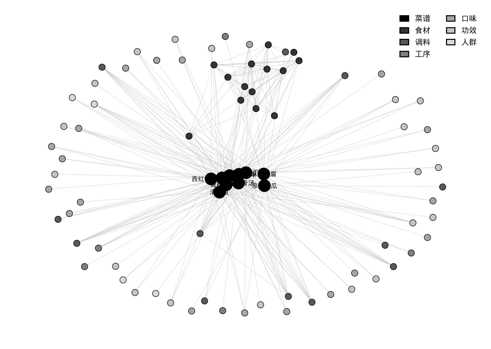
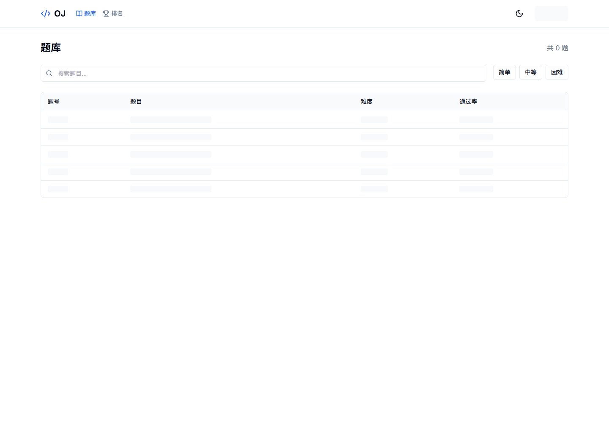
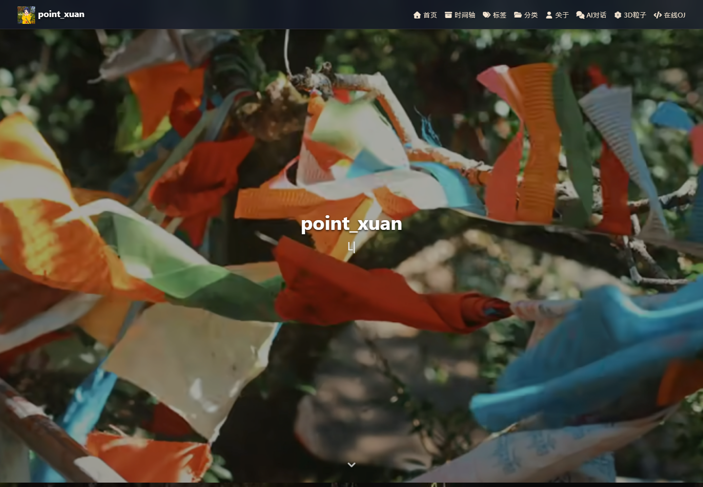

# Open Source Showcase

> hhxpoint 的开源项目索引：微信小程序、AI/知识图谱、RAG、在线判题、Spring Boot 考勤、Hexo 博客、微信小游戏、汇编与 C++ 练习。

  
  
  
  

---

## 项目一览

### 1. 小火苗 · 微信小程序

> 和重要的人一起养一只小火苗：关系空间、投喂/摸摸/抱抱/打卡、悄悄话、时光相册、纪念日、语音信箱。

- 仓库：[hhxpoint/answer](https://github.com/hhxpoint/answer)
- 技术：微信小程序原生、Node.js/Express、SQLite、WebSocket
- 亮点：多关系空间、分享封面系统、乐观发送、聊天缓存、实时同步

---

### 2. RAG 烹饪知识图谱

> 图谱 + BM25 两路召回 + 确定性推理 + 可追溯生成；离线可运行，含完整课程设计报告与演示视频。

- 仓库：[hhxpoint/rag-cooking-kg](https://github.com/hhxpoint/rag-cooking-kg)
- 技术：Python、NetworkX、BM25、D3、标准库 HTTP
- 指标：图谱增强 RAG 准确率 **88.5%** vs 纯文本 **38.5%**

---

### 3. AcOJ 在线判题

> Next.js 14 + Supabase + Python 评测机：Monaco 编辑器、实时评测状态、提交历史、排行榜。

- 仓库：[hhxpoint/online-judge](https://github.com/hhxpoint/online-judge)
- 技术：Next.js、TypeScript、Tailwind、Supabase、Flask、Docker
- 状态：前端 `npm run build` 通过

---

### 4. 职工考勤管理系统

> Spring Boot + MyBatis-Plus + MySQL：部门/员工、打卡、考勤统计、请假审批、公告、日志。

- 仓库：[hhxpoint/attendance-system](https://github.com/hhxpoint/attendance-system)
- 技术：Java 8、Spring Boot 2.7、MyBatis-Plus、MySQL、原生 HTML/JS
- 测试：`mvn test` **3 passed**

---

### 5. 糖葫芦历险记 · 微信小游戏

> 三车道无尽跑酷：换道、跳跃、滑铲、金币、障碍、最高分；Canvas 2D + 对象池。

- 仓库：[hhxpoint/tanghulu-adventure](https://github.com/hhxpoint/tanghulu-adventure)
- 技术：微信小游戏、Canvas 2D、原生 ES6
- 玩法：左右滑动换道 / 上滑跳跃 / 下滑滑铲

---

### 6. point_xuan Blog + AcOJ

> Hexo + Butterfly 技术博客，配套 AcOJ 后端（Express + 腾讯云 CloudBase）。

- 仓库：[hhxpoint/blog-oj](https://github.com/hhxpoint/blog-oj)
- 技术：Hexo 7、Butterfly、Node.js/Express、CloudBase、Redis
- 说明：已移除真实 token/密钥/服务器配置

---

### 7. 汇编与 C++ 课程练习

> 8086 汇编实验（Cop2000）与 Visual C++ 控制台练习归档。

- 仓库：[hhxpoint/academic-projects](https://github.com/hhxpoint/academic-projects)
- 技术：8086 Assembly、C++、Visual Studio
- 内容：算术/排序/数论/位运算/8253/8255 等 90+ 个 `.ASM` 实验

---

### 8. PointCode AI CLI

> 多模型 AI 编程助手 CLI，支持自定义 Provider、Token 计划、插件与主题。

- 仓库：[hhxpoint/pointcode](https://github.com/hhxpoint/pointcode)
- 技术：TypeScript、Bun、Node.js、Ink
- 安装：`npm install -g pointcode`

### 9. 机器学习课程项目合集

> PCA/LDA 人脸识别、猫狗分类、BirdCLEF、IRIS 与 ML 作业；只保留源码/配置/结果图，原始数据与报告不入库。

- 仓库：[hhxpoint/ml-coursework](https://github.com/hhxpoint/ml-coursework)
- 技术：Python、scikit-learn、TensorFlow/Keras、OpenCV

---

### 10. 固定资产管理系统

> JavaWeb + Servlet/JSP + MySQL：资产分类、入库/领用/归还/报废、用户权限、操作记录、统计。

- 仓库：[hhxpoint/asset-management-system](https://github.com/hhxpoint/asset-management-system)
- 技术：Java 8、Servlet 4、JSP、MySQL、Tomcat
- 测试：`mvn test` **2 passed**

---

### 11. 浏览器小游戏合集

> 五子棋（Minimax + 联机）、Soul Shooter（2.5D 射击）、中国象棋（FastAPI + WebSocket）。

- 仓库：[hhxpoint/browser-games](https://github.com/hhxpoint/browser-games)
- 技术：HTML5 Canvas、JavaScript、Godot HTML5、FastAPI
- 截图：五子棋 / Soul Shooter 已归档

---

### 13. 旅游攻略智能体

> LangChain + RAG + ChromaDB 的旅游攻略助手，支持对话、攻略管理、MCP。

- 仓库：[hhxpoint/travel-agent](https://github.com/hhxpoint/travel-agent)
- 技术：Python、Flask、LangChain、ChromaDB

---

### 14. 外卖点餐系统

> Python Tkinter + SQLite 桌面外卖系统：登录、餐厅、购物车、订单、评价、管理后台。

- 仓库：[hhxpoint/food-delivery-system](https://github.com/hhxpoint/food-delivery-system)
- 技术：Python、Tkinter、SQLite

---

### 15. 项目迁移说明

完整盘点、脱敏、测试、远端校验与待确认清单：

- [docs/MIGRATION.md](docs/MIGRATION.md)

---

## 关于

- GitHub：<https://github.com/hhxpoint>
- 所有仓库均附 README、运行环境、启动方式、功能清单与测试/验收说明。
- 代码以 MIT 为主；第三方主题/素材/课程团队项目遵循原许可，不擅自再分发。

## License

本索引页 MIT。各项目许可证以对应仓库为准。
